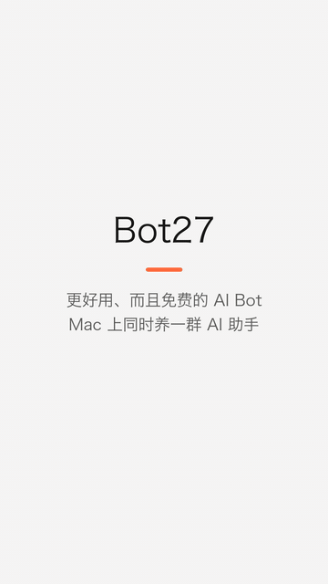

<p align="center"></p>

# Bot27

[中文](README.zh-CN.md)

**A free, open-source personal bot. Use your own model and host it on your own PC.**

<p align="center"></p>

<p align="center"><a href="demo.mp4">Watch the full video</a></p>

## Why Bot27

- **Free.** Uses your existing Claude or ChatGPT login, or your own xAI key.
- **Browser and computer use on your own machine.** Not supported by GrokBot or Muse.
- **Your data.** No account. Chats and memory stay on your computer.
- **Self-hosted.** No server needed.

## Features

- **Many bots**, each with its own name, look, instructions and model.
- **Three providers:** Claude (Claude Code CLI), GPT (Codex CLI), Grok (xAI API).
- **Editable memory** per bot: `AGENTS.md`, `SOUL.md`, `USER.md`, `MEMORY.md`, plus daily notes in `memory/YYYY-MM-DD.md`.
- **Dreaming:** nightly at 3:00 a.m., lasting facts from daily notes move into `MEMORY.md`.
- **One ongoing chat per bot.** Long chats are summarized, not cut off.
- **Tasks and routines:** one-off or scheduled, with intervals, time windows and time zones.
- **Connections** (Claude and GPT): Gmail, Google Calendar and more. Read-only, except email drafts.
- **Computer and browser use** (Claude and GPT): off by default, enabled per bot.

## Requirements

- macOS 14+
- Swift 5.9 (Xcode or Command Line Tools)
- At least one of:
  - [Claude Code](https://claude.com/claude-code), signed in (`claude`)
  - Codex CLI 0.147.0+, signed in (`codex login`)
  - An xAI API key

**Optional setup**

- **Computer use:** grant Bot27 Accessibility and Screen Recording permissions.
- **GPT browser use:** install the ChatGPT desktop app and enable Computer Use there.
- **GPT Gmail:** connect Gmail in ChatGPT with the same account as `codex login`, then turn it on in the bot's **Connections**.
- **Claude browser use:** install [Claude in Chrome](https://code.claude.com/docs/en/chrome#prerequisites) and sign in with your Claude Code account.

## Build

```bash
./build.sh
open build/Bot27.app
```

Quit Bot27 before reopening after a rebuild. If your keychain has a "Bot27 Local Signing" certificate, permissions persist across rebuilds.

## Data

Everything is stored in `~/Library/Application Support/Bot27/`. The xAI key is kept in the macOS Keychain.
