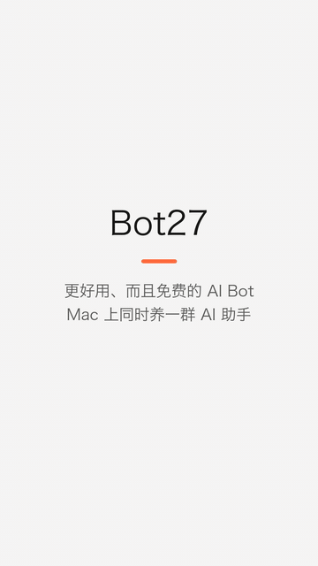

# Bot27

[中文](README.zh-CN.md)

**A better, free Grok Bot.**

<p align="center"></p>

<p align="center"><a href="demo.mp4">Watch the full video</a></p>

## Why it's better

- **Free.** The app costs nothing. Models run on your existing Claude or ChatGPT login, or your own xAI key.
- **Browser and computer use in your Local computer(GrokBot and Muse doesn't support).** Bots can work in Chrome and on your computer 
- **Your data.** There's no Bot27 account or login, and chats and memory are stored only on your computer
- **Self-hosted.** It runs on your own computer, with no server.

## Features

- **Many bots.** Each has its own name, look, instructions and model.
- **Three providers.** Claude runs through the Claude Code CLI, GPT through the Codex CLI, and Grok through the xAI API.
- **Memory.** Each bot keeps three Markdown files that it adds to as you chat, and that you can edit:
  - `SOUL.md`: who the bot is.
  - `USER.md`: who you are.
  - `MEMORY.md`: things worth remembering.
- **Daily notes.** Starting a new session saves the end of the old one to daily notes, which the bot can search.
- **Sessions.** `/new` or `/reset` starts a fresh session. Long chats are summarized instead of cut off.
- **Tasks and routines.** One-off or scheduled jobs. Routines run in sessions of their own.
- **Connections** (Claude only). Gmail, Google Calendar and other claude.ai connectors. They are read-only, except that bots can write email drafts.
- **Computer and browser use** (Claude only). Off by default, and turned on per bot.

## Requirements

- macOS 14 or later
- Swift 5.9, from Xcode or the Command Line Tools
- At least one of:
  - [Claude Code](https://claude.com/claude-code), signed in by running `claude` once in Terminal
  - The Codex CLI, signed in with `codex login`
  - An xAI API key

## Build

```bash
./build.sh
```

```bash
open build/Bot27.app
```

`build.sh` signs the app with a "Bot27 Local Signing" certificate if your keychain has one. With a stable certificate, macOS keeps the Screen Recording and Accessibility permissions across rebuilds.

## Data

Chats and settings stay on your Mac, under `~/Library/Application Support/Bot27/`. Each bot's files are in `memory/<bot-id>/`. An xAI key is stored in the macOS Keychain.
