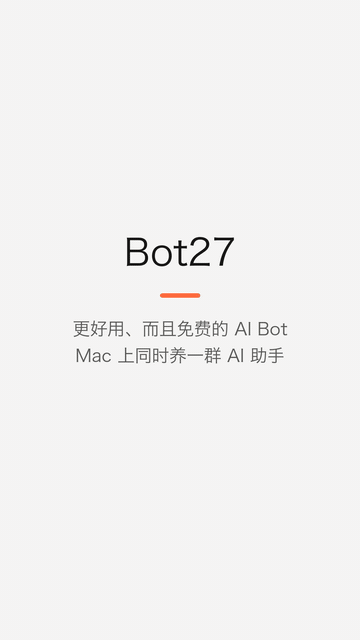

# Bot27

[中文](README.zh-CN.md)

**A better, free Grok Bot.**

<p align="center"></p>

<p align="center"><a href="demo.mp4">Watch the full video</a></p>

## Why it's better

- **Free.** The app costs nothing. Models run on your existing Claude or ChatGPT login, or your own xAI key.
- **Browser and computer use in your Local computer(GrokBot and Muse doesn't support).** Bots can work in Chrome and on your computer 
- **Your data.** There's no Bot27 account or login, and chats and memory are stored only on your computer
- **Self-hosted.** It runs on your own computer, with no server.

## Features

- **Many bots.** Each has its own name, look, instructions and model.
- **Three providers.** Claude runs through the Claude Code CLI, GPT through the Codex CLI, and Grok through the xAI API.
- **Memory.** Each bot keeps three Markdown files that it adds to as you chat, and that you can edit:
  - `SOUL.md`: who the bot is.
  - `USER.md`: who you are.
  - `MEMORY.md`: things worth remembering.
- **Daily notes.** Notes in the bot's `memory/` folder: today's and yesterday's are read in every chat, and the bot can search older ones.
- **One chat per bot.** Each bot keeps one ongoing chat. Long chats are summarized instead of cut off.
- **Tasks and routines.** One-off or scheduled jobs. Routines run in sessions of their own.
- **Connections** (Claude and GPT). GPT uses Gmail through your ChatGPT account; Claude uses Gmail, Google Calendar and other claude.ai connectors. They are read-only, except that bots can write email drafts.
- **Computer and browser use** (Claude and GPT). GPT browser use reuses OpenAI Computer Use from the ChatGPT desktop app; Claude uses Claude in Chrome. Off by default, and turned on per bot.

## Requirements

- macOS 14 or later
- Swift 5.9, from Xcode or the Command Line Tools
- At least one of:
  - [Claude Code](https://claude.com/claude-code), signed in by running `claude` once in Terminal
  - The Codex CLI 0.147.0 or later, signed in with `codex login`
  - An xAI API key

For GPT computer or browser use, enable the corresponding switch in the bot's settings; it keeps its GPT model. Computer use needs Bot27's Accessibility and Screen Recording permissions. GPT browser use needs a current Codex CLI and the OpenAI `unified-computer-use` plugin installed by the ChatGPT desktop app. Bot27 discovers that plugin's `cua_repl` launch configuration and passes only that server to `codex exec`; it does not load your other personal MCP servers or require Claude Code. This integration was verified with Codex CLI 0.167.0. Set the CLI path in Settings to the same installation you use in Terminal if multiple versions are installed.

For GPT Gmail, connect Gmail in ChatGPT using the same account as `codex login`. In the bot’s settings, choose a GPT model, refresh **Connections**, and turn on **Gmail**. You can also ask the bot to connect Gmail in chat. Each provider has its own connection permission; enabling Claude’s Gmail does not enable GPT’s Gmail. Bot27 checks connection metadata through Codex `app-server` without reading mail or making a model request. Each reply enables only Gmail’s approved search, read and draft tools; sending, deleting, labeling and other apps remain disabled. A current Codex CLI with `app/installed` and `app/read` support is required.

Open ChatGPT and enable Computer Use before using GPT browser tasks. Keep its runtime installed and grant the permissions it requests. Codex can use the browser interface or operate the Chrome window through native Computer Use when the browser interface has an integration error. Native window control can move focus; the browser-only task scope is an instruction, not an OS-level application sandbox. Site permissions and runtime permission denials still apply. The on-screen Stop bar ends the current CLI run and its tool process group; actions already delivered to a page cannot be undone by cancellation.

Claude browser use continues to use the Claude Code CLI and Claude in Chrome extension. Sign in through the extension with the same account and organization as Claude Code. See [Anthropic's prerequisites](https://code.claude.com/docs/en/chrome#prerequisites). If navigation reports that it could not verify a site's safety category, check the extension's sign-in and network connection. A connected browser or a successful tool listing alone does not verify navigation or playback.

## Build

```bash
./build.sh
```

```bash
open build/Bot27.app
```

If Bot27 is already running, quit it before reopening after a build. Rebuilding the app does not update the running process.

`build.sh` signs the app with a "Bot27 Local Signing" certificate if your keychain has one. With a stable certificate, macOS keeps the Screen Recording and Accessibility permissions across rebuilds.

## Data

Chats and settings stay on your Mac, under `~/Library/Application Support/Bot27/`. Each bot's files are in `memory/<bot-id>/`. An xAI key is stored in the macOS Keychain.
