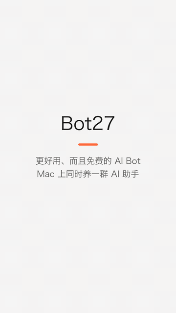

<p align="center"></p>

# Bot27

[English](README.md)

**一个免费、开源的个人 bot。使用你自己的模型，部署在你自己的电脑上。**

<p align="center"></p>

<p align="center"><a href="demo.mp4">看完整视频</a></p>

## 为什么选 Bot27

- **免费**：用你已有的 Claude 或 ChatGPT 登录，或你自己的 xAI key。
- **在你自己的电脑上操作浏览器和电脑**：GrokBot 和 Muse 都不支持。
- **数据归你**：无需账号，聊天和记忆只存在你的电脑上。
- **自托管**：不需要服务器。

## 功能

- **多个 bot**：各自有名字、头像、指令和模型。
- **三种模型来源**：Claude（Claude Code CLI）、GPT（Codex CLI）、Grok（xAI API）。
- **可编辑的记忆**：每个 bot 有 `AGENTS.md`、`SOUL.md`、`USER.md`、`MEMORY.md`，以及每日笔记 `memory/YYYY-MM-DD.md`。
- **夜间整理**：每天凌晨 3 点把每日笔记中的长期信息整理进 `MEMORY.md`。
- **一个 bot 一个会话**：聊天太长会自动总结，不会截断。
- **任务和定时任务**：单次或定时运行，支持间隔、运行时段和时区。
- **连接**（Claude 和 GPT）：Gmail、Google 日历等。只读，唯一例外是写邮件草稿。
- **电脑和浏览器操作**（Claude 和 GPT）：默认关闭，可为每个 bot 单独开启。

## 运行要求

- macOS 14+
- Swift 5.9（Xcode 或 Command Line Tools）
- 至少满足一项：
  - [Claude Code](https://claude.com/claude-code)，已登录（`claude`）
  - Codex CLI 0.147.0+，已登录（`codex login`）
  - 一个 xAI API key

**可选设置**

- **电脑操作**：授予 Bot27「辅助功能」和「屏幕录制」权限。
- **GPT 浏览器操作**：安装 ChatGPT 桌面应用，并在其中开启 Computer Use。
- **GPT Gmail**：在 ChatGPT 中用与 `codex login` 相同的账号连接 Gmail，再在 bot 的 **Connections** 中开启。
- **Claude 浏览器操作**：安装 [Claude in Chrome](https://code.claude.com/docs/en/chrome#prerequisites)，并登录与 Claude Code 相同的账号。

## 构建

```bash
./build.sh
open build/Bot27.app
```

重新构建后请先退出 Bot27 再打开。如果钥匙串里有 "Bot27 Local Signing" 证书，重新构建后权限会保留。

## 数据

所有数据保存在 `~/Library/Application Support/Bot27/`，xAI key 保存在 macOS 钥匙串中。
