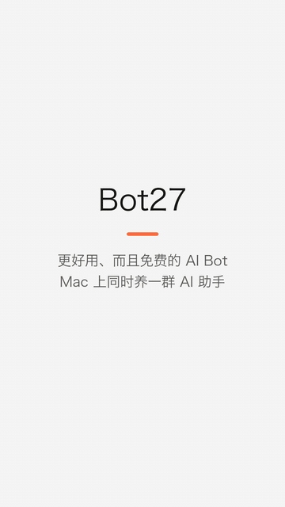

# Bot27

[English](README.md)

**一个更好用、而且免费的 Grok Bot。**

<p align="center"></p>

<p align="center"><a href="demo.mp4">看完整视频</a></p>

## 好在哪里

- **免费**：应用本身免费。模型用你已有的 Claude 或 ChatGPT 登录，或者你自己的 xAI key。
- **在你自己的电脑上操作浏览器和电脑（GrokBot 和 Muse 都不支持）**：bot 可以在 Chrome 里和你的电脑上帮你做事。
- **数据归你**：不用注册或登录 Bot27，聊天记录和记忆只存在你自己的电脑上。
- **自托管**：直接在你自己的电脑上运行，不需要服务器。

## 功能

- **多个 bot**：每个 bot 有自己的名字、头像、指令和模型。
- **三种模型来源**：Claude 通过 Claude Code CLI，GPT 通过 Codex CLI，Grok 通过 xAI API。
- **记忆**：每个 bot 有自己的 Markdown 文件，你可以手动编辑：
  - `AGENTS.md`：工作区规则，每次加载，由用户维护
  - `SOUL.md`：bot 是谁
  - `USER.md`：你是谁
  - `MEMORY.md`：值得记住的事
- **每日笔记**：主聊天内容按本地日期自动保存到 `memory/YYYY-MM-DD.md`，启动时会从保留的聊天记录补写遗漏消息，保留已有笔记且不重复写入。定时任务和错误消息不写入。每次聊天都会读今天和昨天的笔记，更早的可以搜索。
- **夜间整理**：在 Settings → Memory 开启 Dreaming 后，应用运行时每天凌晨 3 点将每日笔记中的长期信息整理进 `MEMORY.md`；错过的运行会在重新打开应用时补做。
- **一个 bot 一个会话**：每个 bot 只有一段持续的聊天。聊天太长时会自动总结，而不是直接截断。
- **任务和定时任务**：可以手动运行的任务，也可以按时间自动运行的定时任务。定时任务在单独的会话里运行。
- **连接**（仅限 Claude）：Gmail、Google 日历等 claude.ai 连接器。只能读取，唯一的例外是可以写邮件草稿。
- **电脑操作和浏览器操作**（Claude 和 GPT）：GPT 浏览器操作复用 ChatGPT 桌面应用的 OpenAI Computer Use；Claude 使用 Claude in Chrome。默认关闭，可以为每个 bot 单独开启。

## 运行要求

- macOS 14 或更高版本
- Swift 5.9（来自 Xcode 或 Command Line Tools）
- 至少满足以下一项：
  - 安装 [Claude Code](https://claude.com/claude-code)，并在终端运行一次 `claude` 完成登录
  - 安装 Codex CLI 0.147.0 或更高版本，并用 `codex login` 登录
  - 一个 xAI API key

在 bot 设置中开启电脑操作或浏览器操作后，GPT bot 会继续使用原来的 GPT 模型。电脑操作需要授予 Bot27「辅助功能」和「屏幕录制」权限。GPT 浏览器操作需要新版 Codex CLI，以及由 ChatGPT 桌面应用安装的 OpenAI `unified-computer-use` 插件。Bot27 自动读取其中的 `cua_repl` 启动配置，仅把这个服务传给 `codex exec`，不加载其他个人 MCP 服务，也不需要 Claude Code。此接入已在 Codex CLI 0.167.0 上验证；如果电脑上存在多个 CLI 版本，请在 Settings 中填写与终端相同的 CLI 路径。

请先在 ChatGPT 中开启 Computer Use，保留其运行时并授予它请求的系统权限。GPT 可使用浏览器接口；接口发生集成错误时，也可通过原生 Computer Use 操作 Chrome 窗口。原生窗口操作可能切换焦点；限定 Chrome 的任务范围依靠指令，并非操作系统级的应用隔离。运行时的权限拒绝和网站权限仍然有效。屏幕顶部 Stop 按钮结束当前 CLI 及其工具进程组；已经发送到页面的操作无法通过取消撤回。

Claude 浏览器操作继续使用 Claude Code CLI 和 Claude in Chrome 扩展。请在扩展中登录与 Claude Code 相同的账号和组织，详见 [Anthropic 的使用要求](https://code.claude.com/docs/en/chrome#prerequisites)。如果导航提示无法验证网站安全分类，请检查扩展的登录状态和网络连接。浏览器已连接或成功列出工具，并不代表导航和播放已经可用。

## 构建

```bash
./build.sh
```

```bash
open build/Bot27.app
```

如果 Bot27 正在运行，重新构建后请先退出应用，再打开。构建不会自动更新已经运行的进程。

如果钥匙串里有名为 "Bot27 Local Signing" 的证书，`build.sh` 会用它给应用签名。证书不变，macOS 就会在每次重新构建后保留"屏幕录制"和"辅助功能"权限。

## 数据

聊天记录和设置都只保存在你的 Mac 上，位于 `~/Library/Application Support/Bot27/`。每个 bot 的文件在 `memory/<bot-id>/` 里。xAI API key 保存在 macOS 钥匙串中。
